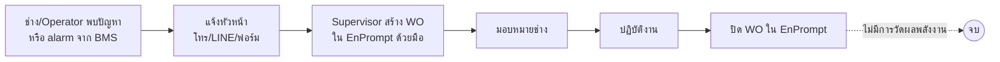
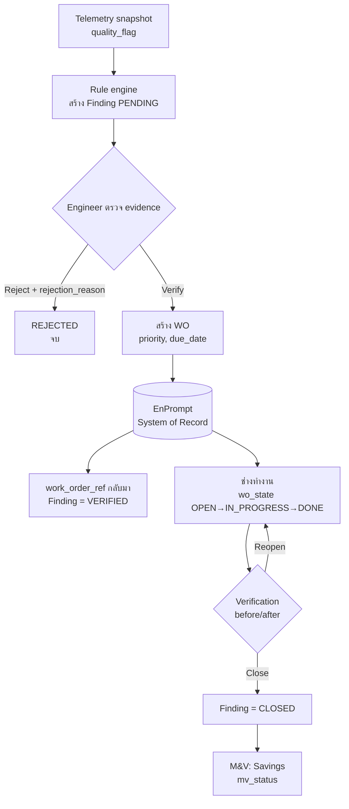
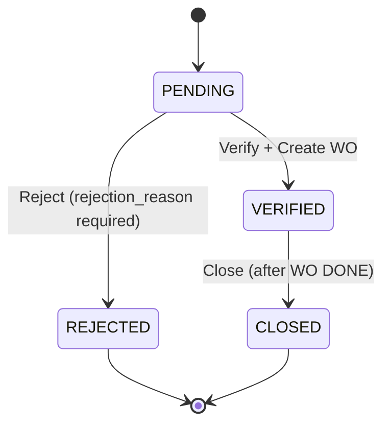
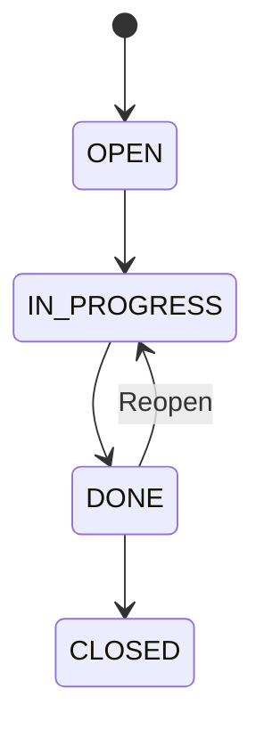
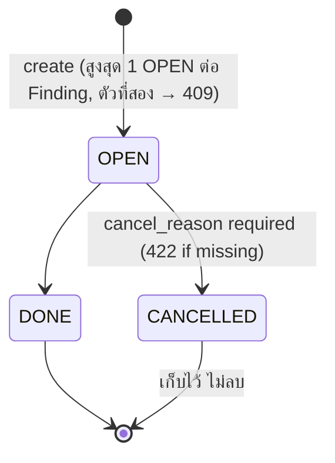
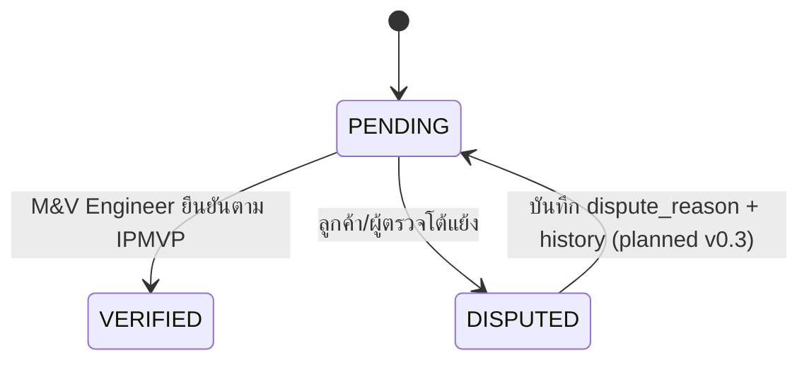

# Process Flow — Work Order (EnPrompt)

> EnPrompt เป็น System of Record ของ Asset และ Work Order · as-is เป็น **Assumption** รอยืนยัน (Q2)

## As-is (ปัจจุบัน — Assumption)

Pain points: ตรวจพบช้า (reactive), ไม่มี evidence เชิงข้อมูล, ไม่วัด Saving หลังแก้

## To-be (Pilot กับ EnCo XP)

หมายเหตุ: ระบบไม่สั่งงาน BMS; ใน Pilot การสร้าง WO ใช้ mock จนกว่าจะยืนยัน EnPrompt API

## Finding status

Transition อื่น (เช่น PENDING→CLOSED, REJECTED→CLOSED) → **409 Conflict**

## Work Order state (`wo_state`, เจ้าของคือ EnPrompt)

## WorkOrder status — planned in Contract v0.3

`Finding.work_order_ref` ชี้ไป WO ที่ OPEN ตัวเดียว (planned in Contract v0.3)

## M&V status (`mv_status`)

แสดงตัวเลข Saving เฉพาะ `VERIFIED` · DISPUTED→PENDING พร้อม `dispute_reason` และ status-change history = **planned in Contract v0.3** (Architect ยืนยันแล้ว ยังไม่มีในโค้ด)
